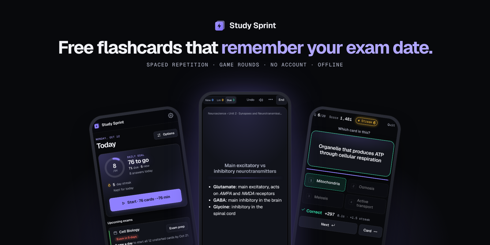
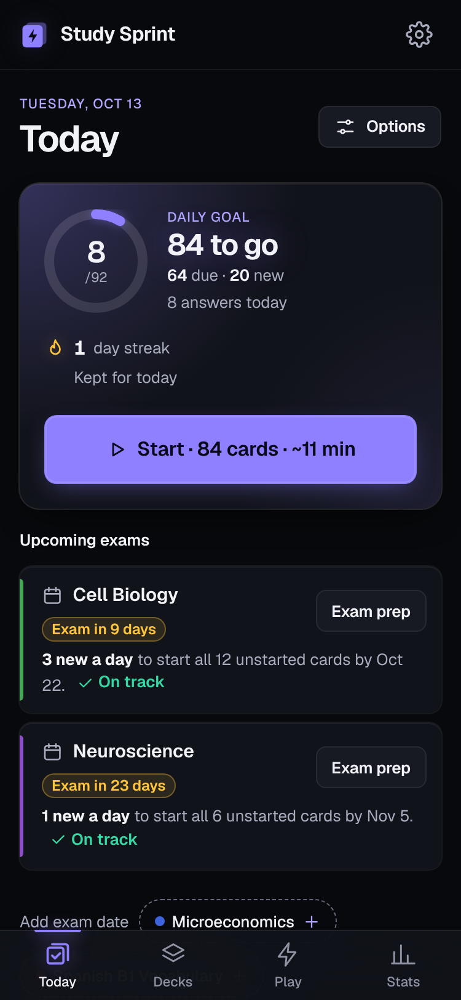
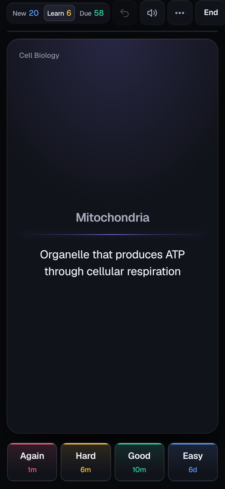
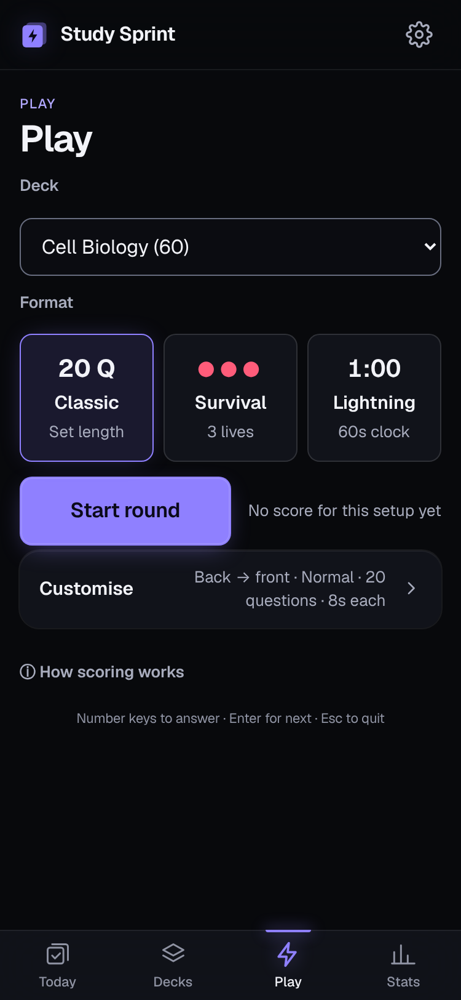
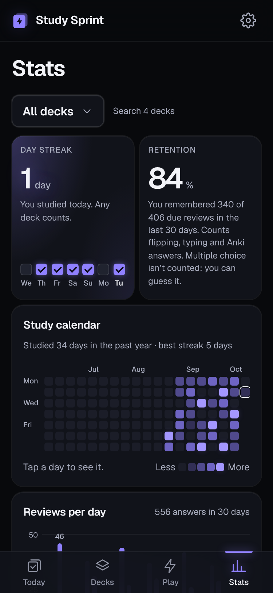
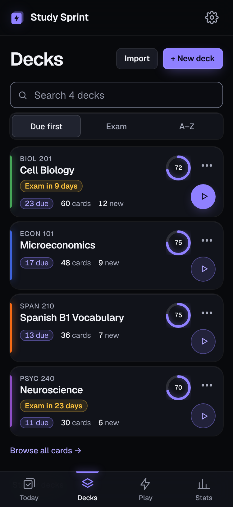
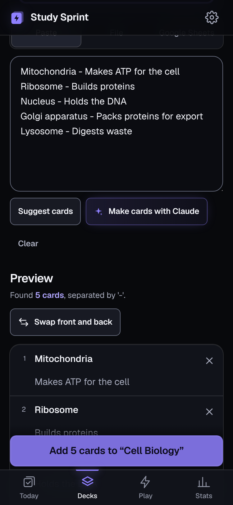

# Study Sprint ⚡

A mobile-first flashcard app for university courses. It combines real spaced repetition (FSRS-6, like modern Anki) with timed game rounds for cramming, and your game answers feed the review schedule automatically.

<p align="center">
  <picture>
    <source media="(prefers-color-scheme: light)" srcset="docs/hero-light.png">
    
  </picture>
</p>

<p align="center"><b>Free flashcards that remember your exam date.</b><br>
Real spaced repetition (FSRS-6) · timed game rounds · no ads, no account, works offline.</p>

<p align="center"><a href="https://aayan277.github.io/study-sprint/"><b>Open the app →</b></a></p>

<p align="center">
  
  
  
  
  
  
</p>

## Why Study Sprint

| | Study Sprint | Anki | Quizlet (free) |
| --- | --- | --- | --- |
| Price | Free, no ads | Free, but the iPhone app is paid | Free with ads; the best study modes are paid |
| Spaced repetition | FSRS-6, with an exam-date mode | FSRS | Basic |
| Timed game rounds that update your schedule | Yes | No | Games don't change your schedule |
| Works offline, installs on your phone | Yes (PWA) | Yes (native apps) | Needs the paid app |
| Imports Anki decks, Quizlet exports, CSV, Excel | Yes | Anki decks and text files | Pasted text and files |
| Needs an account | No (optional sync) | No (AnkiWeb for sync) | Yes |

## Headline features

- **Spaced repetition that fits your day.** One Start button on Today for everything due, with a time estimate from your own pace.
- **Exam date mode.** Give a course an exam date and every card comes back before it; Exam prep goes over what you haven't seen lately.
- **Timed game rounds.** Classic, Survival and Lightning rounds for cramming, and right answers on due cards count as reviews.
- **Paste notes, get cards.** Paste almost any format, or import .apkg, Quizlet, CSV and Excel, and check an editable preview first.
- **Stats that mean something.** Retention, a year-long study calendar, hardest cards and a readiness ring for each course.
- **Yours.** Works offline, keeps your data on your device, syncs only if you sign in, and installs from the browser as a home-screen app.

<details>
<summary><b>The full feature list</b></summary>

- **Decks:** create, rename, recolor and delete decks. Each shows its cards, how many are due and new (the same numbers Review will show today, with what waits until tomorrow explained on the deck's page), a mastery ring and a Study button; an empty deck offers + Add cards. On a deck's page, Edit, Add subdeck and Export are in a ⋯ menu. A deck can have its own new-cards-per-day limit (Edit), inside the overall one.
- **Formatting:** **bold**, *italics* and bullet lists on cards. On a phone, the B / I / • buttons add simple marks (`**bold**`, `*italic*`, `- item`) with a live preview; on a computer, the box shows formatting as you type (Ctrl/⌘+B, Ctrl/⌘+I). Typed answers and Play use the plain text. Anki imports keep bold, italics and lists, and Anki exports turn them back into formatting.
- **Cloze cards:** hide parts of a sentence, like Anki. In Add a card choose **Cloze**, select words and press **New blank** (Ctrl/⌘+Shift+C) or **Same blank as the last one** (Ctrl/⌘+Alt+Shift+C): `The {{c1::mitochondria::organelle}} makes {{c2::ATP}}`. A live preview says how many cards it makes. Each blank is its own card with its own schedule; **Review shows only one card of a note a day** (Today counts the same), Exam prep shows all of them, and Play never asks two of a note back to back. Editing any card opens the whole note; removing a blank asks first, because its card and history go. Anki cloze notes import as notes and export as Anki Cloze notes, pasted lines with blanks like `{{c1::answer}}` become cloze notes by themselves (next to ordinary `term - definition` lines; one link keeps them as plain cards), and Browse → Tools → **Link cloze cards** (opt-in, with a preview) joins older separate cards into notes without touching their schedules.
- **Image occlusion:** hide parts of a diagram, like Anki's "hide all, guess one". In Add a card choose **Image occlusion** and **Choose a picture** (on a computer you can also drop a file or paste a screenshot). The box editor opens: drag with one finger or the mouse to cover a part, tap a box to select it, drag it to move it or a corner to resize it, pinch (or scroll, or double-tap) to zoom, and use **Group** to make several boxes one card, **Label** to name a part, and **Undo/Redo**. On a computer, Delete, arrows (Alt resizes), G, L, Ctrl/⌘+Z and Tab work too. Each group of boxes is its own card with its own schedule; **Review shows one card of a picture a day**, hides every box and asks you to name the highlighted one, and the answer side can show the whole picture. Pictures are kept at up to 2048px so small text stays readable. Editing a card's boxes keeps every card's schedule; removing or joining boxes asks first, because a card and its history go. Anki's image-occlusion notes import with their boxes and export as real Anki Image Occlusion notes (Anki 23.10+).
- **Step-by-step problems:** in Add a card (Basic) switch on **Answer in steps**, add a box for each step (+ Add step, move up or down, delete) and an optional Final answer. The back is saved as `Step 1: …`, `Step 2: …` lines (so any card written that way is step-by-step). In Review, after the flip, **Space, Enter or →** reveals one step at a time (focus follows each step), **A** shows them all, the rating buttons appear after the last step (1–4 work any time), there is no typing for these cards, and Read aloud reads the steps shown. Play asks for the final answer.
- **Memory hook:** the optional "Memory hook" field on a Basic card is shown under the answer in Review and added to Back as an Extra line in the Anki export.
- **Scratchpad:** the pen button in Review (or **D**) lets you draw on the card with a pen, finger or mouse (pen strokes ignore a resting palm). Pen, Eraser, Clear and Close appear on the card. On or off is remembered on this device; drawings are never saved: a flip keeps them, the next card starts clean.
- **Pictures:** one picture on each side of a card (the picture button next to B / I / •). Photos are shrunk automatically (longest side 1280px), shown in Review and Play, synced between devices (Supabase Storage: run `supabase/media.sql`), kept in backups, and brought along by Anki imports and exports.
- **Exam date mode** (Edit deck → Exam date): cards you should still remember at 99% or better on exam day are left alone, even if their next review falls after the exam. The rest get a **final pass**: spread over the last 3 days (fewer if the exam is closer), the weakest closest to the exam, with the reviews that add most to your exam-day recall first. It is worked out whenever the day's queue is built, so cards added later (Anki import, moved in, a new subdeck) are covered too. Retention rises to 95% over the last two weeks, and **Exam prep** goes over every card you haven't seen in 3 days, the ones you're least likely to remember first. Today also says how many **new cards a day** finish the deck by the exam, with one tap to set it (it asks first). A countdown shows on the deck; after the exam it goes back to normal.
- **Export** (a deck's page → Export): save a deck as a spreadsheet (.csv) or an Anki deck (.apkg), with tags. Re-exporting updates the cards in Anki instead of duplicating them.
- **Card list** (each deck's page, or Decks → Browse all cards):
  - Search, filter (new, learning, due, suspended, buried, flags, leeches) and sort (date added, due, most forgotten, hardest, A–Z).
  - Tap a card to edit it, suspend it, bury it until tomorrow, flag it, move it, reset it to new, set its due date, delete it, or see its full history (Card info).
  - Select several cards to do any of these to all of them at once, and add single cards with + Add card.
  - **Tools:** a Duplicates filter (same front, written differently), **Find and replace** across selected cards, and **Tags** to rename or remove a tag everywhere.
  - Suspended and buried cards are left out of Review and Play.
- **Import** (the fastest way in):
  - Paste notes in almost any format: `term - definition`, tabs, `|`, `:`, `=`, commas, numbered or bulleted lists, Notion and markdown tables, **bold** terms, Quizlet exports, or term and definition on separate lines. The format is detected for you.
  - Upload .csv, .tsv, .txt or Excel (.xlsx) files, or load a shared Google Sheet. A CSV that Export wrote comes back whole: cells with line breaks, blank lines and bullets are kept, and the Tags column is read. The deck picker is at the top and starts on the deck of your last import; the save button says where the cards go ("Add 12 cards to “Biology”").
  - Export (CSV) puts a `'` in front of any cell that starts with `=`, `+`, `-`, `@`, a tab or a line break, so Excel and Sheets don't run it as a formula; Import takes it off again (only for a file with the export's own `Front,Back,Tags` header). Tags are written comma-separated, so a tag with a space stays one tag.
  - **Anki decks** (.apkg, from Anki's File → Export, or shared decks from AnkiWeb): old and new Anki formats. Pick one Anki deck or all of them; tags come along, cloze notes stay one note with a card per blank (Back Extra is kept), image-occlusion notes keep their boxes (one card per box group, with the header, labels and Back Extra), and formatting and sounds are left out.
  - **Anki progress:** if the deck was exported with “Include scheduling information”, a switch brings over each card's review history (shown as Anki in Card info and counted in Stats) and rebuilds its due date by replaying those reviews through FSRS with the deck's own settings, the way Anki's own FSRS reads them: cram reviews from filtered decks are ignored, Forget resets the card, and a history that starts partway starts from Anki's interval and ease. Off, or with no history, cards start as new.
  - Check everything in an editable preview first: fix cells, delete rows, swap front and back, pick columns, and see duplicates flagged.
  - **Make cards with Claude** copies a ready-made prompt with your notes, to paste into Claude.
- **Today** (the home screen): your day streak, a daily goal ring, one **Start** button for everything due (with a time estimate from your own answer speed), a row per course to study just that deck, and your upcoming exams. The streak is a button: it opens **Your streak** (see **Streak freeze and days off** below). **Add exam date** chips offer a quick way to give a course an exam: tap the course, pick In 1, 2 or 4 weeks (or a date) and Save, and it joins the upcoming exams. The deck page has the same button. **Options** on Today holds which decks to study, answering by flipping or typing, and Custom study.
- **Typed answers show what went wrong:** when a typed answer is wrong or needed a typo forgiven, Review and Play line it up with the answer and mark the wrong, extra and missing letters (bold wavy, struck through, dotted with a caret, so colour is never the only cue), with a short summary like "1 letter wrong · 1 missing". Capitals, accents, punctuation and a leading the/a/an are never marked. Very different answers just show both texts. Play's missed list keeps the marks.
- **Maths on cards:** write a formula between dollar signs, like `$x^2$` in a line or `$$\frac{a}{b}$$` on its own line (Anki's `\(...\)` and `\[...\]` work too), and it is drawn with KaTeX in Review, Play, Browse, Stats and the editors (the ∑ button wraps the selection; a preview shows under the box). Prices are safe: `$5 and $10` stays text, because the closing `$` must follow a word with no space before it and no digit after it. Type `\$` for a plain dollar sign. Long formulas scroll inside their own box. The maths files come from a CDN the first time a card needs them and are then kept for offline use, so before that (offline on the very first visit) a formula shows as its raw text. Typed answers take the plain-text version (`x^2`, `a/b`, `sqrt(x)`), read-aloud says it in words, and Anki import and export keep formulas. Imported libraries are checked against fingerprints (an import map in `index.html`), so a changed file is never run. A formula KaTeX can't read shows as typed. A blank hidden inside a formula (a cloze `{{c1::...}}` that starts inside `$...$`, as Anki allows) shows as typed text, not a blank; a formula inside a blank (`{{c1::$x^2$}}`) works.
- **Review:** daily spaced repetition with FSRS-6. The card turns over when you flip it (a quick fade if your device asks for reduced motion).
  - Flip a card (tap or Space) or type the answer, then rate it Again / Hard / Good / Easy. Each button shows when the card comes back.
  - Undo, keyboard shortcuts (Space flip, 1–4 rate, E edit, I card info, - bury, @ suspend, R read aloud), and a summary at the end.
  - **Read aloud:** 🔊 (or R) reads the card with your device's voices; each deck picks a language (or works it out from the text) and can read cards out automatically.
  - A thin **progress bar** under the header fills as you go (cards done out of cards done plus cards left, with cards coming back to relearn counted as left).
  - The ⋯ button opens a short sheet: **Edit**, **Flag**, **Bury**, **Suspend** and **More** (More is the full card panel: move, reset, set due date, delete, card info). Edit is a short editor (Front, Back, Tags, formatting and pictures) with Cancel and Save always in view; saving closes the sheet and you are back on the same card.
  - **Back from a break:** after a few days away, Today may say "150 overdue cards piled up. Spread them over 2 or 3 days?" (it shows when 30 or more are overdue and that is at least twice your usual day). Choosing it gives you about a half or a third of the overdue cards each day, the most overdue first, on top of what is due that day. New cards are paused until you've caught up (a switch; decks with an exam keep theirs, and exam decks are never held back). Today shows "Catch-up plan: day 2 of 3 · 64 left"; skipping a day just means more the next day, and **Show everything now** cancels it. "Not today" hides the offer until tomorrow. The plan syncs between devices and is part of a backup.
  - **Custom study** (Today → Options): add extra new cards for today, review ahead (cards due in the next day to 2 weeks), or go over the cards you forgot today. It also has **By tag or question ID** (paste the IDs of the questions you missed in UWorld or AMBOSS, or pick a tag or a folder of `::` tags, then **Unsuspend** the cards or **Study now**, which unsuspends them and starts a session with just those cards; it looks in all decks) and **Postpone reviews** (push today's due reviews back 1 day to a week, the ones you'll still remember best first; nothing is logged, and Undo puts them back). In Browse → Tools, `::` tags (like AnKing's) show as folders to open, rename, remove or show, and the search box understands `tag:#uworld::step`.
  - **Play "I was right":** after a wrong typed answer, **I was right** counts it right in the round (accuracy, grade, Missed list) but not in the score, streak or lives; then **Accept “…” from now on** adds it to the card's accepted answers (Edit → Other accepted answers). With "Count Play answers as reviews" on, it also fixes the schedule and stats. Typed Review has **Accept my answer from now on**.
  - **Leeches:** a card you forget 8 times (changeable in Settings) is tagged “leech” and suspended (or just tagged), like Anki. Misses in Play on cards that weren't due don't count.
  - Advanced scheduling in Settings: learning and relearning steps, a maximum interval (handy before exams), spreading due dates onto the least busy days, and **easy days** (Normal / Reduced / Minimum per weekday).
  - **Reviews per day** (optional; no limit by default), overall and per deck.
  - **Per-deck settings** (Edit deck → Study options): a deck can have its own retention, steps, maximum interval, and new and review limits, or use the overall ones.
  - **Subdecks**: put a deck inside another (+ Subdeck, or Edit deck → Inside), e.g. Psych 101 › Unit 1. A deck includes its subdecks in its card list, Review, Play, Stats and Export; its limits cap them all; and they use its settings, exam date and read-aloud language unless they set their own. Anki imports can keep their subdecks.
- **Play:** timed rounds. The deck (it opens on the one with the nearest exam), the format and Start come first; the question type, Hard, Flash, question count and time are under **Customise**.
  - **Classic** (10/20/40 questions), **Survival** (3 lives, shrinking timer) and **Lightning** (60 seconds).
  - Front → back, back → front, or typing. Definition-style decks start on back → front (read the definition, pick the term), and your own pick is remembered per deck.
  - **Hard** mode (6 lookalike options) and **Flash** (the question vanishes).
  - Streak scoring, an S–D grade and best scores.
  - **Card ⋯** after each answer opens the same short card sheet (pauses the round).
- **You mix these up:** when a wrong multiple-choice pick in Play is another card's answer (or a wrong typed answer is exactly another card's answer), the answer is logged with `mixedWith`. A pair mixed up twice or more in 90 days shows on the Play results as **You mix these up** (up to 3) and as "Often mixed up with: X (3×) · Compare" in the card panel. **Compare** puts the two cards side by side (stacked on a phone) and offers **Review these** (the two cards in a Review session), **Make a comparison card** and **Not confused** (hides the pair on this device until it happens twice more). Time-outs and skips never count, and neither do two cards of one note.
- **Cards you keep forgetting:** when a card becomes a leech (forgotten as many times as Settings says), the end of the Review session or Play round lists it with ways to fix it: **Memory hook** (a trick shown under the answer), **Split** into 2 to 4 smaller cards, **Comparison** with a look-alike card, **Edit**, **Delete**, **Keep suspended** or **Fix later**. A fixed card comes back with its schedule as it was. Cards left to fix are under the Leeches filter in All cards (`#/browse/leech`), with an "N cards to fix" link on Decks and Stats.
- **Auto-grading:** a Play answer on a due card counts as its review (fast, normal, slow or wrong becomes Easy, Good, Hard or Again). Once you have about 50 right answers in a mode, "fast" and "slow" are judged against your own usual speed for that much text instead of the timer. A right multiple-choice answer on a due card counts at most as Hard, since picking an answer is easier than recalling it. A miss on a card that isn't due still brings it back, but doesn't count toward the leech limit, and a Survival timeout with under 3 seconds allowed is only logged. In a deck with an exam coming up, a new card's first Play answer is its first review too (within the new-cards-per-day limit).
- **Works on phones and computers:** on a computer (1024px and wider) the tabs become a sidebar, lists and Stats use the full width, a card's panel opens beside the card list (1200px+), and Review shows a bigger card with its keyboard shortcuts. From 1200px a deck's page has three columns: the tree of decks on the left, the deck in the middle, and the card editor docked on the right. Phones keep the bottom tabs and pop-up sheets.
- **Sheets:** every pop-up has the same frame: the title and a × at the top right, and the buttons in a footer that stays in view (the main button on the right, Cancel beside it). On a phone, drag the sheet down by its grab bar to close it.
- **Sync** (Settings → Sync): sign in with the same email and password on each device, and your decks, cards, progress, review history and study settings stay the same everywhere. Works offline and catches up when you're back online; the newest change wins, and a delete on one device deletes everywhere. Theme stays per device. Forgot password, change password, sign out (keep or remove this device's copy) and delete your synced data are all in Settings → Sync. Setup: [docs/sync-setup.md](docs/sync-setup.md).
- **Stats:** (the readiness number is an estimate, with a "How sure is this?" note saying so: it uses the standard FSRS memory model until you have your own, and assumes you stop reviewing now)
  - day streak (with its streak freeze and days off) and retention (recall answers only: flipping, typing and Anki, not multiple choice)
  - a study calendar: a year of study days as squares (darker = more answers), with your best streak. Days a streak freeze covered have a diagonal hatch, days off a dotted pattern
  - reviews per day for 30 days, and cards due over the next 7 days
  - hardest cards, with a **Review these** button (a Review session of those cards)
  - under **More stats** on phones (always shown on a computer): answer buttons (how often you press Again / Hard / Good / Easy), the time of day you remember best, how FSRS difficulty is spread across your cards, and a mastery grid you can tap card by card
- **Streak freeze and days off** (v4.1):
  - **Streak freeze:** one missed day a week is covered for you, so a single slip doesn't end your streak. It is automatic and not saved up (a week runs Monday 4am to Monday 4am). A covered day keeps the streak alive but doesn't add to the count, and two missed days in a row still break it. Today and the sidebar say when one was used or is ready, and Stats marks the covered day with a snowflake (hatched in the calendar).
  - **Days off:** tap the streak on Today (or "Plan a day off" in Stats) to plan days off for an exam week or a trip: starting tomorrow, up to 60 days ahead, up to 14 at a time, and you can remove them again. A day off never breaks the streak and doesn't add to it. Courses with an exam offer a one-tap "Day off on exam day". Days off sync between your devices (two devices that each add one keep both).
  - **How it is worked out:** from your review history each time, nothing extra is stored, so every device agrees once they have synced. Because of that, streaks (and the best streak) you already had may now be longer than before: the freeze is applied to all your history.
  - **Time zones:** days are named in the time zone your device is in now (a day starts at 4am there). If you travel or change time zone, a day's boundary moves with it, so one day can look doubled or missed around the change; the freeze usually absorbs that.
- **Backups:** export everything to one file and restore it on any device (Settings → Your data).
- **Starter decks:** optional JLPT N5 and N4 kanji decks, tucked away (Decks tab → Starter decks, or Import → Ready-made decks).
- **First run:** a fresh install opens on a landing-style welcome screen (a mini card with the four rating intervals; two columns on a computer), then a short, skippable start: name your course, add cards (the sample cards come first, or paste, or a file), and a guided review of 3 cards that ends by showing when each card comes back. It never shows again (Today's "How it works" link re-opens it), and existing users never see it. An empty Today offers Paste notes, Try sample cards and How it works.
- **Install card:** after your first finished Review session, Today offers to install the app (Install / Not now on Android and desktop, Add to Home Screen steps on iPhone Safari). It is remembered per device, hidden once the app is installed, and Settings has an Install app row.
- **Themes:** 5 accent colors (Violet, Ocean, Forest, Ember, Rose), each in dark (the default) and light, plus an OLED black option. Fonts are Geist and Geist Mono (monospace only for numbers and key hints).
- **Appearance** (Settings → Appearance, this device only; none of these sync):
  - **Card text alignment** is Auto (short text centred, long answers left-aligned so they are easier to read), Center or Left. It applies to Review, the first-run card and Play questions.
  - **Compact deck list** (on by default): Decks gets a search box (course name, code or subdeck) and a sort (Due first, Exam, A–Z); subdecks fold under their course (what you open is remembered); each deck has a small round play button instead of a full-width Study button; and on a computer the tiles keep their own height. Turn it off for the earlier list.
  - **Exam readiness in Stats** (on by default): pick one course in Stats (a searchable deck tree) and a header shows a readiness ring (the share of its cards predicted at 90% or better on exam day, or today if there is no exam), the exam badge, how many cards you have seen and how many are mature, and an Exam prep button. Mastery moves to the top. Turn it off for the plain deck list and no header.
  - **Rating feedback** (on by default): when you rate a card in Review, a ring in the rating's colour pulses on the button, the new interval ("10m", "9d") floats up, and a plain outline of the old card drifts away in a direction that suits the rating (Again back into the pile, Good and Easy lifting away). The next card is drawn at once, never held back for the effect, and is never tinted. Turn it off for no effect at all.
  - **Smooth transitions** (on by default): moving between tabs slides the new screen in (the header and tab bar stay still), and pop-up sheets spring open and slide away. Not used during Review or Play rounds. Turn it off for instant changes.
  - Some motion has no switch: the goal ring on Today fills from where it was and turns green when the goal is done, the Review finish screen counts its numbers up (with a small confetti burst at most once a day, when you clear the whole queue of 5 or more cards, and a one-time badge at 7, 30 and 100 days), and Play has combo flames, a score count-up and a heavier grade stamp. If your device is set to reduce motion, none of it moves: numbers are simply shown and everything else stays still.
- **Works offline,** installs on your phone, and keeps your data on your device.

</details>

## Install it on your phone

1. Open the link above in **Safari** (iPhone) or **Chrome** (Android).
2. iPhone: tap **Share → Add to Home Screen**. Android: tap **⋮ → Install app**.
3. It opens full screen from its own icon and works without internet.

On a computer, open the link in Chrome or Edge and use the install button in the address bar.

## Your data

Everything is saved in your browser (IndexedDB) on your device, and it all works offline with no account. An account is optional: if you want your decks on more than one device, sign in under Settings → Sync (accounts and storage come from your own Supabase project, see [docs/sync-setup.md](docs/sync-setup.md)). Without one, nothing leaves your device.

- The home-screen app and a browser tab can have **separate** storage (especially on iPhone), so pick one and stick with it.
- **Export a backup now and then** (Settings → Back up). To move to a new phone or computer, export there and choose **Import backup** on the new device.

## How it's built

Plain HTML, CSS and JavaScript modules. There's no build step, so GitHub Pages serves the files exactly as they are. Libraries come from a CDN at pinned versions: [ts-fsrs](https://github.com/open-spaced-repetition/ts-fsrs) 5.4.2 for scheduling, SheetJS, loaded only when you import an Excel file, and fflate, fzstd and sql.js, loaded only when you import an Anki deck.

| File | What it does |
| --- | --- |
| `index.html` | Page frame: header, screen area, bottom tab bar |
| `css/styles.css` | All styles. The theme colors are at the top |
| `js/app.js` | Starts the app, switches screens, Settings and backups |
| `js/db.js` | Saving and loading (IndexedDB), backup export and restore |
| `js/decks.js` | Deck list, deck page, create/edit/delete, starter decks |
| `js/browse.js`, `js/browse-logic.js` | The card list: search, filters, sorting, and every card action |
| `js/import.js` | Format detection for pasted text, files and sheets |
| `js/import-screen.js` | The Import screen and its preview |
| `js/cloze.js` | Cloze cards: blanks, safe rendering, saving and healing notes, the link finder |
| `js/occlusion.js`, `js/occlusion-view.js`, `js/occlusion-editor.js` | Image occlusion: box maths and saving, pinch-zoom viewer, the drawing editor |
| `js/anki.js` | Turns Anki notes into cards (HTML to text, cloze, decks, tags) |
| `js/anki-read.js` | Opens .apkg files (unzip, decompress, read the SQLite database) |
| `js/sync-data.js` | Sync groundwork: change times, review ids and deleted markers on every save |
| `js/sync.js`, `js/sync-merge.js`, `js/supa.js`, `js/sync-config.js` | Syncing: when to sync, which version wins, the small Supabase client, and which project |
| `js/password.js` | Password rules for new passwords (8+ characters, a letter and a number) |
| `js/export.js` | Exporting a deck as CSV or an Anki deck |
| `js/exam.js` | Exam date mode: the final pass, limits, pulling cards in, Exam prep, new cards a day |
| `js/format.js`, `js/card-editor.js` | Card formatting: marks ↔ HTML, and the B / I / • editor |
| `js/media.js` | Pictures: shrinking, saving and showing them |
| `js/speech.js` | Reading cards aloud |
| `js/balance.js` | Evening out reviews across days, and easy days |
| `js/deck-tree.js` | Subdecks: paths, what's inside a deck, inherited settings, and the rows of a searchable deck tree |
| `js/deck-picker.js` | A searchable deck tree in a sheet (Stats uses it; written to be reused) |
| `js/exam-sheet.js` | Setting an exam date: the short "Add exam date" sheet, and the save shared with Edit deck |
| `supabase/setup.sql`, `supabase/media.sql`, `docs/sync-setup.md` | Setting up a Supabase project for sync |
| `js/today.js`, `js/study-data.js` | The Today home screen, and the data Today and Review share |
| `js/rescue-sheet.js` | The "Back from a break" catch-up plan sheet (lazy) |
| `js/onboarding.js` | The first-run start (landing-page welcome, name, add cards) and the guided first review |
| `js/install.js` | The Install card on Today and the Install app row in Settings |
| `js/review.js` | The Review session (flip, rate, finish) |
| `js/srs.js` | FSRS-6 scheduling (wraps ts-fsrs) |
| `js/sched-settings.js` | Checking and applying the advanced scheduling settings |
| `js/queue.js`, `js/days.js` | Which cards are due today (a study day starts at 4am) |
| `js/match.js` | Checking typed answers (typos, alternates, articles, spaces) |
| `js/answer-diff.js` | Which letters of a typed answer were wrong (marks wrong, extra and missing letters) |
| `js/math.js` | Finding `$...$` maths in card text, maths as plain words and speech, and loading KaTeX when a card first shows it |
| `js/play.js` | The Play screen |
| `js/game.js` | Game rules: scoring, timers, wrong-answer options |
| `js/leech-coach.js`, `js/leech-logic.js` | "Cards you keep forgetting" on the finish screens: Memory hook, Split, Comparison, Edit, Delete, Keep suspended, Fix later |
| `js/confusion.js`, `js/compare-sheet.js` | "You mix these up": pairs from `mixedWith` log rows, and the Compare sheet (side by side, Review these, comparison card, Not confused) |
| `js/autograde.js` | Turning Play answers into review ratings |
| `js/stats.js`, `js/stats-calc.js` | The Stats screen and the numbers behind it (the streak walk with its freeze and days off is in `stats-calc.js`) |
| `js/streak-sheet.js` | The "Your streak" sheet: the freeze explained, the last 7 days, planning and removing days off |
| `js/jlpt.js` | The optional JLPT kanji starter decks |
| `js/themes.js`, `js/sample.js`, `js/ui.js` | Themes, the sample deck, shared helpers |
| `tests/browser/readme-shots.mjs` | Makes the README and manifest screenshots in `docs/screenshots/` from the real app |
| `tests/*.test.js` | Tests for every rule above that doesn't need a browser |
| `sw.js`, `manifest.webmanifest`, `icons/` | Offline support and installing as an app |

The full plan, including what's planned next, is in [PLAN.md](PLAN.md).

## Running it on your computer

ES modules don't load from a `file://` address, so use a tiny local server:

```
npx http-server -c-1
```

Then open the address it prints.

## Releasing a change

Phones keep the old copy of the app files until `CACHE` in `sw.js` changes. So **bump `CACHE` (for example `v37` to `v38`)
on every release that changes any app file**, then run `node tests/update-sw-hash.mjs` to save the files' new fingerprint
in `sw.js` (it covers `css/`, `js/`, `icons/`, `index.html` and the manifest). `npm test` fails with a reminder until you do both.

If the look of the app changed, also run `node tests/browser/readme-shots.mjs`: it remakes the screenshots in `docs/screenshots/`
(Today, Review, Play, Stats, Decks, Import and a computer shot) from the real app in Violet Dark. The README and the manifest
(`screenshots`) use them, so they never go stale. The pictures at the top of the README (`docs/hero.png` and `docs/hero-light.png`)
and the link-preview image (`icons/og-1200x630.png`) are designed pictures: redo them only when the headline changes.

## Running the tests

```
node --test
```

`node tests/sim/exam-sim.mjs` simulates 300 cards up to an exam and prints the reviews per day and the predicted exam-day recall (it needs `npm install --no-save ts-fsrs@5.4.2` once). To run one file, use for example `node tests/import.test.js`. No install is needed: it uses Node's built-in test runner. `package.json` only tells Node the files are modules.

### Browser tests

`tests/browser` has tests that open the app in a real (hidden) browser and click through it: Review, Play,
import and export, sync (against a fake Supabase), subdecks and more. Each check prints PASS or FAIL.

```
npm run test:browser            # all of them (a few minutes)
npm run test:browser review     # only the ones with "review" in the name
```

On Claude Code's cloud computers this works as is. On your own computer, install the browser tools once:
`npm install --no-save playwright && npx playwright install chromium`. Screenshots and downloads go in
`tests/browser/out`. `tests/browser/files` has the sample files the tests import (Anki decks, a spreadsheet);
`make-files` has the Python scripts that made the Anki ones (they need the `anki` Python package).

## Redesign (v3.0, experiment branch)

What changed across the three steps (details in PLAN.md):

1. **Look:** a dark and sleek look with new design tokens; five accent themes (Violet, Ocean, Forest, Ember, Rose) in dark and light, plus OLED black; rating colors fixed so Again / Hard / Good / Easy never change with the theme; a focus mode that hides the tab bar and header during a round; and contrast fixes. Geist fonts.
2. **Today:** a home screen (the first tab) with a daily goal ring, streak, one Start button, a row per course with a mastery ring and upcoming exams. The card now flips, the finish screen was redone, and emoji were replaced by one set of icons. The old Review setup lives in Today → Options.
3. **Shorter screens and a first run:** a skippable first-run start (pitch, name your course, add cards, guided review) that existing users never see; JLPT starter decks tucked away under "Starter decks"; Stats folds four sections under "More stats" on phones only; Settings moves timer and leech options into Advanced scheduling and Reset into a Danger zone; card filters are grouped; Play opens with deck, format and Start above the fold with the rest under "Customise"; and Play starts new cards in decks with an exam coming up. Along the way: fixes for focus-mode leaks, a toast hidden by the rating bar, theme preview redraws, a late Review redraw hiding the tab bar, count labels, and the exam test around midnight.
4. **Speed and Today follow-ups:** Stats, Today and Browse are much quicker on big libraries (10,000 cards); other screens load when first opened and the app opens from its saved files at once, updating in the background. Starting a session while another is going resumes it (same decks) or asks first; the flipped card moves focus to the answer for screen readers and the keyboard; the Today time estimate uses the real time between answers.
5. **Visual polish (v3.2):** Start and every label in the app font, exams in amber (red only in the last 3 days), Again in crimson so it never looks like Ember's orange, a calm deck label and readable long answers on cards, framed pictures, one deck-page stripe and one empty state, finer Stats chart scales with a shorter Hardest list, one 1120px content width on desktop, and a more careful Today time estimate (only answers under 45 seconds apart, from Review's own recent history).
6. **Layout polish (v3.3):** a short card sheet in Review and Play with Save returning to the card; one sheet frame everywhere (× at the top right, a sticky footer, a grab bar that really drags); a Review progress bar; Decks that scale (search, sort, folded subdecks, small play buttons); exam date in three taps from Today; a per-course readiness header in Stats; and a three-column Decks page on wide screens.
